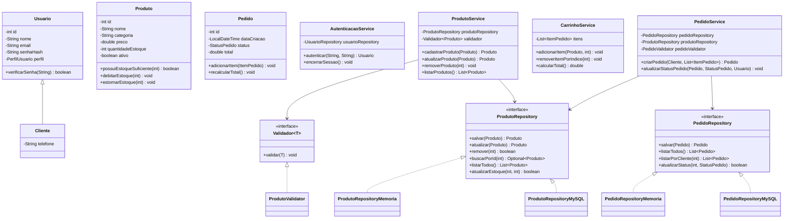

# Relatório Técnico de Refatoração e Aplicação dos Princípios SOLID — Projeto TechNova

**Autor:** Gusthavo Gassen  
**Projeto Base (Desktop Anterior):** [https://github.com/gugadev1/PI2](https://github.com/gugadev1/PI2)  
**Objetivo:** Revisar, refatorar e desacoplar as regras de negócio da interface gráfica Java Swing, aplicando os princípios **SOLID** e padrões de projeto para permitir o reaproveitamento integral do núcleo de negócios na construção do novo Sistema Web.

---

## 1. Diagnóstico do Projeto Original e *Code Smells* Encontrados

Na análise do projeto desktop anterior (`PI2`), foram identificados os seguintes *code smells* (maus cheiros de código) que impediam o reaproveitamento das classes em uma aplicação Web:

1. ***God Class / Large Class* e Lógica de Negócio na Interface Gráfica (`TechNovaDesktopUI.java`)**:
   - A classe `TechNovaDesktopUI` possuía **580 linhas** e acumulava múltiplas responsabilidades: construía componentes visuais (`JFrame`, `JPanel`, `JTable`), armazenava listas de dados em memória (`usuariosSistema`, `produtos`, `pedidos`, `itensCarrinho`), controlava IDs sequenciais (`proximoIdProduto`, `proximoIdPedido`), validava formulários, autenticava usuários (`autenticarUsuario()`), gerenciava o carrinho de compras (`adicionarItemCarrinho()`) e disparava diálogos `JOptionPane`.
   - **Impacto:** Nenhuma dessas funcionalidades (login, CRUD de produtos, carrinho de compras) podia ser reutilizada em um controlador Web (Servlet/Spring/JSF) porque estavam presas a eventos e componentes do Java Swing.

2. ***Duplicated Code* (Código Duplicado)**:
   - A validação de campos obrigatórios e valores não negativos de `Produto` estava duplicada entre `TechNovaDesktopUI.criarProdutoPorFormulario()` e `ProdutoDAO.cadastrar()`.
   - A validação de estoque e itens do pedido estava duplicada entre `PedidoService.validarEstoque()` e `PedidoDAO.cadastrar()`.
   - Em `ClienteDAO`, o código de mapeamento das colunas do `ResultSet` (`id`, `nome`, `email`, `senha_hash`, `telefone`) para o objeto `Cliente` estava copiado identicamente nos métodos `listar()` e `buscarPorId()`.

3. ***Long Method* (Método Longo)**:
   - Os métodos `PedidoDAO.cadastrar()` e `PedidoDAO.listarPorCliente()` realizavam abertura de conexão, controle manual de transação, múltiplos `PreparedStatement` em lote e mapeamento relacional complexo dentro de um único bloco extenso.

4. ***Silent Exception Swallowing* (Captura Silenciosa de Exceções)**:
   - Em `ProdutoDAO`, `ClienteDAO` e `PedidoDAO`, blocos `catch (SQLException e) { return false; }` ocultavam completamente a causa real de falhas de banco de dados.

5. ***Hardcoded Credentials / Tight Coupling* (Acoplamento Rígido e Credenciais Fixas)**:
   - `ConexaoMySQL` continha usuário e senha fixos em constantes estáticas e era chamada diretamente via método estático `ConexaoMySQL.obterConexao()` dentro dos DAOs, impossibilitando testes sem um servidor MySQL ativo.

6. ***Anemic Domain Model / Feature Envy* (Modelo de Domínio Anêmico)**:
   - As entidades `Produto`, `PerfilUsuario` e `StatusPedido` eram apenas estruturas de dados passivas. O cálculo de baixa de estoque era feito fora de `Produto` (`PedidoService.baixarEstoque`), e não havia validação de transição de status nem de permissão de perfil.

---

## 2. Princípios SOLID Aplicados e Classes Afetadas

### 2.1. SRP — Princípio da Responsabilidade Única (*Single Responsibility Principle*)
> *"Uma classe deve ter um, e apenas um, motivo para mudar."*

- **Classes Afetadas / Criadas:**
  - `TechNovaDesktopUI` (refatorada)
  - `AutenticacaoService`, `ProdutoService`, `ClienteService`, `CarrinhoService`, `PedidoService` (criadas/refatoradas em `com.technova.service`)
  - `ProdutoValidator`, `ClienteValidator`, `PedidoValidator` (criadas em `com.technova.validation`)
  - `ProdutoRepositoryMySQL`, `ClienteRepositoryMySQL`, `PedidoRepositoryMySQL` (refatoradas a partir dos antigos DAOs)
- **Justificativa:**
  - As regras de autenticação, cadastro/validação de produtos e controle do carrinho de compras foram **extraídas de `TechNovaDesktopUI`** para classes de serviço independentes (`AutenticacaoService`, `ProdutoService`, `CarrinhoService`).
  - As regras de validação de dados de entrada foram isoladas em classes validadoras (`ProdutoValidator`, `ClienteValidator`, `PedidoValidator`), retirando essa responsabilidade tanto da tela Swing quanto dos DAOs.
  - Agora, `TechNovaDesktopUI` cuida apenas da exibição desktop (Swing), os `*Validator` cuidam apenas de regras de validação, os `*Service` orquestram as regras de negócio (prontos para o sistema Web) e os `*Repository` cuidam exclusivamente da persistência.

### 2.2. OCP — Princípio do Aberto/Fechado (*Open/Closed Principle*)
> *"Entidades de software devem estar abertas para extensão, mas fechadas para modificação."*

- **Classes Afetadas / Criadas:**
  - `Validador<T>` (interface) e suas implementações `ProdutoValidator`, `ClienteValidator`
  - `ProdutoService`, `ClienteService`
  - `StatusPedido` e `PerfilUsuario`
- **Justificativa:**
  - `ProdutoService` e `ClienteService` dependem da abstração `Validador<T>`. Caso o sistema Web exija novas regras de validação (por exemplo, validação de CNPJ/CPF ou regras promocionais), basta fornecer uma nova implementação de `Validador<T>` sem modificar o código de `ProdutoService` ou `ClienteService`.
  - Os enums `StatusPedido` (`podeTransicionarPara`) e `PerfilUsuario` (`podeAlterarStatusPedido`, `podeRemoverProdutos`) encapsulam o comportamento de cada estado/perfil sem exigir cadeias de `if/else` espalhadas pelos serviços.

### 2.3. LSP — Princípio da Substituição de Liskov (*Liskov Substitution Principle*)
> *"Subtipos devem ser substituíveis por seus tipos base sem alterar a corretude do programa."*

- **Classes Afetadas / Criadas:**
  - Hierarquia `Usuario` $\leftarrow$ `Cliente`
  - Hierarquia de exceções `RegraNegocioException` $\leftarrow$ `ValidacaoException`
  - Implementações de `ProdutoRepository` (`ProdutoRepositoryMemoria` e `ProdutoRepositoryMySQL`), `ClienteRepository` e `PedidoRepository`
- **Justificativa:**
  - `Cliente` estende `Usuario` preservando integralmente o contrato da superclasse (com perfil `PerfilUsuario.CLIENTE` configurado automaticamente), podendo ser utilizado em qualquer operação que receba um `Usuario` (como verificação de permissões em `PedidoService.atualizarStatusPedido`).
  - Tanto os repositórios em memória (`*RepositoryMemoria`) quanto os repositórios JDBC (`*RepositoryMySQL`) respeitam rigorosamente os contratos de suas interfaces, permitindo substituir um pelo outro nos serviços sem quebrar nenhuma funcionalidade.

### 2.4. ISP — Princípio da Segregação de Interfaces (*Interface Segregation Principle*)
> *"Muitas interfaces específicas são melhores do que uma única interface geral."*

- **Classes Afetadas / Criadas:**
  - `ProdutoRepository`, `ClienteRepository`, `PedidoRepository`, `UsuarioRepository`
- **Justificativa:**
  - Em vez de criar uma interface genérica monolítica (`GenericDAO`) que obrigasse todas as entidades a implementar métodos que não fazem sentido para seu contexto (como `atualizarEstoque` para `Cliente`, ou `listarPorCliente` para `Produto`), foram criadas interfaces granulares e coesas para cada agregado do domínio.

### 2.5. DIP — Princípio da Inversão de Dependência (*Dependency Inversion Principle*)
> *"Módulos de alto nível não devem depender de módulos de baixo nível. Ambos devem depender de abstrações."*

- **Classes Afetadas / Criadas:**
  - Módulos de alto nível: `AutenticacaoService`, `ProdutoService`, `ClienteService`, `PedidoService`, `TechNovaDesktopUI`
  - Abstrações: `UsuarioRepository`, `ProdutoRepository`, `ClienteRepository`, `PedidoRepository`, `Validador<T>`
  - Módulos de baixo nível: `ProdutoRepositoryMySQL`, `ProdutoRepositoryMemoria`, `ClienteRepositoryMySQL`, `ClienteRepositoryMemoria`, `PedidoRepositoryMySQL`, `PedidoRepositoryMemoria`, `UsuarioRepositoryMemoria`
- **Justificativa:**
  - No projeto original, `PedidoDAO`, `ProdutoDAO` e `ClienteDAO` eram classes concretas fortemente acopladas a `ConexaoMySQL`, e `TechNovaDesktopUI` instanciava diretamente `new PedidoService()` e listas internas.
  - Após a refatoração, todas as classes de serviço recebem suas dependências via **Injeção de Dependência por Construtor** apontando para interfaces (`*Repository`). Isso permite que o mesmo `PedidoService` funcione com dados em memória nos testes do `main()`, com JDBC no Desktop e com JPA/Hibernate ou JDBC na futura aplicação Web.

---

## 3. Refatorações e Padrões de Projeto Aplicados

| Refatoração / Padrão | Classes e Métodos Afetados | Justificativa Técnica |
| :--- | :--- | :--- |
| **Extract Class (Extração de Classe)** | `TechNovaDesktopUI` $\rightarrow$ `AutenticacaoService`, `ProdutoService`, `CarrinhoService` | Retirou toda a lógica de autenticação (`autenticarUsuario`), CRUD de produtos (`adicionarProduto`, `atualizarProdutoSelecionado`, `removerProdutoSelecionado`) e controle de carrinho (`adicionarItemCarrinho`, `removerItemCarrinhoSelecionado`) de dentro do `JFrame`, tornando-as reutilizáveis no sistema Web. |
| **Extract Method (Extração de Método)** | `ClienteRepositoryMySQL.mapearCliente()`, `ProdutoRepositoryMySQL.mapearProduto()`, `PedidoRepositoryMySQL.inserirCabecalhoPedido()`, `inserirItensEBaixarEstoque()` | Eliminou a duplicação de código no mapeamento de `ResultSet` e decompôs o método longo `PedidoDAO.cadastrar()` em métodos privados menores, coesos e de fácil leitura. |
| **Move Method (Mover Método / Enriquecimento de Domínio)** | `PedidoService.baixarEstoque()` $\rightarrow$ `Produto.debitarEstoque()`, `Produto.estornarEstoque()`, `Produto.possuiEstoqueSuficiente()` | Eliminou o *Feature Envy*, movendo a regra de manipulação do saldo de estoque para a própria entidade `Produto`, além de adicionar suporte a estorno automático quando um pedido é cancelado. |
| **Padrão Repository / DAO com Injeção de Dependência** | Pacotes `com.technova.repository`, `.memory` e `.mysql` | Desacoplou as regras de negócio da tecnologia de banco de dados (JDBC/MySQL), viabilizando testes rápidos em memória no método `main()` e facilitando a migração para Web. |
| **Padrão Strategy (Validação)** | `Validador<T>`, `ProdutoValidator`, `ClienteValidator`, `PedidoValidator` | Centralizou as validações que antes estavam duplicadas entre a UI Swing e os DAOs em classes especialistas intercambiáveis. |
| **Padrão Factory (`ConnectionFactory`)** | `ConexaoMySQL` $\rightarrow$ `ConnectionFactory.obterConexao()` | Substituiu a classe estática com senha fixa por uma fábrica configurável via construtor ou variáveis de ambiente (`TECHNOVA_DB_URL`, `TECHNOVA_DB_USER`, `TECHNOVA_DB_PASSWORD`). |
| **Substituição de Código de Erro por Exceções** | `RegraNegocioException`, `ValidacaoException`, `PersistenciaException` | Eliminou os blocos `catch (SQLException e) { return false; }` e os `JOptionPane` misturados à lógica, permitindo que tanto o Desktop quanto o futuro sistema Web tratem erros de forma adequada à sua interface. |

---

## 4. Diagrama de Classes da Arquitetura Refatorada

---

## 5. Testes Implementados no Método `main()` (`TechNovaApp.java`)

Para certificar que todas as regras de negócio funcionam de maneira autônoma e independente do Java Swing, a classe `com.technova.app.TechNovaApp` implementa uma bateria de **14 asserções automatizadas** divididas em 4 blocos funcionais:

1. **Bloco 1 — `AutenticacaoService` (RF001)**:
   - Autenticação com sucesso de usuário `ADMINISTRADOR`;
   - Rejeição de login com senha incorreta (`RegraNegocioException`);
   - Validação de campos obrigatórios de e-mail e senha em branco (`ValidacaoException`).
2. **Bloco 2 — `ProdutoService` e `ProdutoValidator` (RF002)**:
   - Cadastro de novo produto e geração de ID;
   - Bloqueio de cadastro de produto com preço negativo (`ValidacaoException`);
   - Atualização de preço e persistência da alteração.
3. **Bloco 3 — `ClienteService` e `ClienteValidator` (RF003)**:
   - Cadastro de cliente válido;
   - Bloqueio de cadastro de cliente com formato de e-mail inválido (`ValidacaoException`).
4. **Bloco 4 — `CarrinhoService` e `PedidoService` (RF004, RF005, RF006 e RF007)**:
   - Consolidação automática de quantidades ao adicionar o mesmo produto duas vezes no carrinho;
   - Cálculo exato do valor total do carrinho;
   - Bloqueio de adição de itens ao carrinho em quantidade superior ao estoque disponível;
   - Criação do pedido com status `EM_PROCESSAMENTO` e baixa automática do saldo de estoque dos produtos;
   - Atualização de status para `APROVADO` por usuário `ADMINISTRADOR` e bloqueio de alteração de status por perfil `CLIENTE`;
   - Cancelamento do pedido (`CANCELADO`) com **estorno automático das quantidades ao estoque**.
